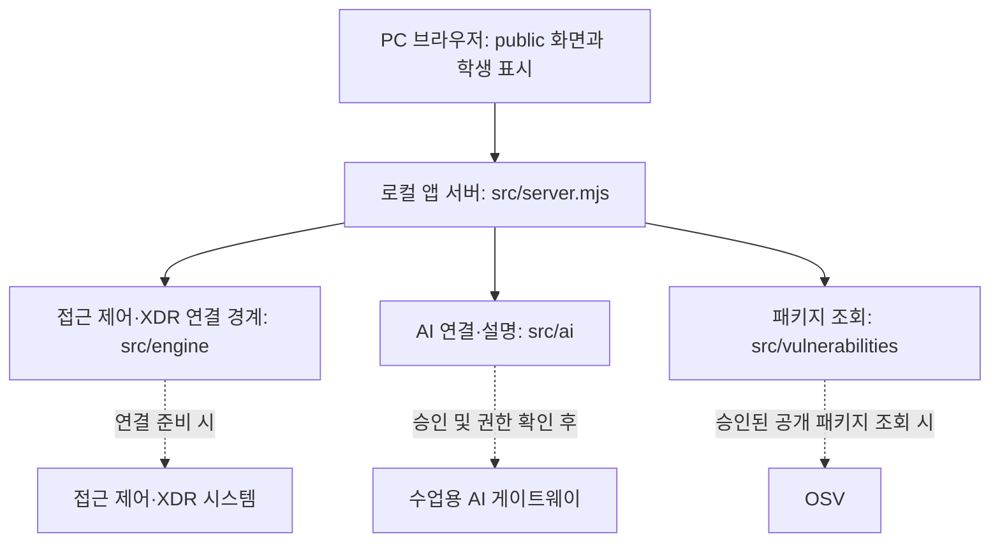

# momobom 학생 실행 설명서

이 문서는 `on-client` 보안 Agent의 실행과 확인 범위를 설명합니다. 직원의 계정·기기·세션, 업무 앱 판정, 최근 보안 기록, AI 설명, 조치 상태와 알려진 취약점 조회 결과를 구분해 표시합니다. 제공 화면과 학생 화면이 함께 동작하며, 실제 외부 시스템 연결 여부는 각 화면에서 확인해야 합니다.

## 환경과 위치

| 항목 | 내용 |
|---|---|
| 시작 틀 | `on-client/package.json` 기준 0.2.21 |
| Node.js | 제공 문서의 검수 기준 24.19.0, 제공 실행 안내의 지원 범위 22~24. 이 PC에서는 v24.21.0 실행 메시지를 확인했습니다. |
| 실행 환경 | Windows PowerShell과 웹 브라우저. 이 PC에서 Windows 실행을 확인했으며 다른 OS 재현은 미확인입니다. |
| Git 최상위 | `C:\Users\nthca\choi-bujang-secret-vault-submit` |
| 앱 폴더 | Git 최상위의 `on-client` |
| 의존성 | `on-client/package.json`에는 외부 npm 의존성이 없습니다. 패키지를 추가하거나 버전을 낮출 필요가 없습니다. |

다른 PC에서는 자신의 프로젝트 경로를 사용합니다. 비밀번호·토큰·개인키·API 키를 이 문서나 저장소에 적지 않습니다.

## 폴더와 역할

| 경로 | 역할 |
|---|---|
| `on-client/README.md` | 제공 시작 틀의 목적·버전·기본 실행 안내 |
| `on-client/student/extension.mjs` | 학생 화면 렌더링 함수 |
| `on-client/public/` | 제공 브라우저 화면과 연결 코드 |
| `on-client/src/server.mjs` | 로컬 앱 서버 |
| `on-client/src/engine.mjs`, `src/engine/` | 기존 시스템 연결 경계 |
| `on-client/src/ai/` | 앱 서버의 AI 연결과 설명 처리 |
| `on-client/src/actions/` | 제공 조치 준비·전달·결과 처리 |
| `on-client/src/vulnerabilities/` | 설치 패키지와 OSV 조회 처리 |
| `on-client/tools/start-alekov.ps1` | Windows 실행 도구 |
| `on-client/docs/` | 제공 안내와 이 학생 문서 |

## 실행·종료·재실행

1. 파일 탐색기에서 위 앱 폴더를 열고 주소창에 `powershell`을 입력해 새 창을 엽니다.
2. 아래 명령을 실행합니다.

```powershell
powershell -NoProfile -ExecutionPolicy Bypass -File .\tools\start-alekov.ps1
```

3. `케셰브가 켜졌습니다`와 브라우저 주소 안내가 나오면 [http://127.0.0.1:5189/](http://127.0.0.1:5189/)를 엽니다. 서버 응답 확인은 AI나 접근 제어 서버 연결 성공을 뜻하지 않습니다.
4. 종료하려면 실행한 PowerShell 창에서 `Ctrl+C`를 누릅니다. 다시 실행하려면 같은 앱 폴더에서 위 명령을 다시 실행합니다. 이미 실행 중이면 중복 실행하지 말고 기존 창을 확인합니다.

예제 화면은 앱 폴더에서 `npm.cmd run demo`로 실행할 수 있습니다. 예제 자료는 실제 계정이나 회사 서버의 연결 결과가 아닙니다. `npm.cmd run check`는 `student/extension.mjs`의 문법 검사입니다.

## 글로 쓴 구성도



브라우저는 로컬 서버의 결과를 표시합니다. 서버는 연결 상태와 권한에 따라 기존 시스템과 AI 게이트웨이의 결과를 전달합니다. 패키지 조회는 승인된 공개 대상에 한합니다. 점선은 조건부 연결이며 현재 실제 연결이 성공했다는 뜻이 아닙니다.

## 제공 코드와 학생 구현

| 구분 | 내용 |
|---|---|
| 제공 | `public/app.js`의 메뉴·입력 전달·재조회·취소와 `src/`의 서버 및 연결 처리 |
| 학생 `renderIdentity` | 계정·기기·세션과 상태 표시 |
| 학생 `renderDecision` | 선택한 업무 앱의 판정·이유·시각 표시 |
| 학생 `renderEvents` | 기록 목록·필터·상세 및 미지원 조치 안내 |
| 학생 `renderStatus` | 기기·세션·알림·안전한 도움정보 표시 |
| 학생 `renderAiConnection` | AI 연결 점검 상태 표시 |
| 학생 `renderExplanation` | 사건의 근거·규칙·상태와 참고용 설명 표시 |
| 학생 `renderAction` | 준비·전달·접수와 효과 관측 상태 구분 |
| 학생 `renderVulnerabilities` | 설치 버전과 OSV 조회 상태·출처·취약점 ID 표시 |

## 확인과 미확인

| 항목 | 확인 범위 |
|---|---|
| 실행 | 2026-10-30에 이 PC의 새 PowerShell 창에서 실행 도구로 서버 응답과 보호 현황 화면을 확인했습니다. 다른 PC에서의 재현은 미확인입니다. |
| AI 연결 점검 | 앱 권한 확인 후 모델 응답 점검 `verified`, 모델 수 1을 화면에서 확인했습니다. 모델 목록 점검은 사건 설명 실행이 아닙니다. |
| 보안 기록 | 실제 환경에서 기존 서버·에이전트 연결을 확인할 수 없다는 화면을 확인했습니다. 실제 사건 AI 설명은 미확인입니다. |
| 조치 | 미실행과 기다림(UNV) 안내를 화면에서 확인했습니다. 실제 학생 계정의 조치 집행과 결과 관측은 미확인입니다. |
| 취약점 | 실제 화면에서 `not_configured`와 제공 화면의 `PROJECT_NOT_CONFIGURED`를 확인했습니다. 실제 설치 버전 대조와 OSV 조회는 미확인입니다. |
| 상태별 분기 | 개발 환경의 모의 입력으로 점검했습니다. 모의 결과는 실제 외부 시스템 실행 결과가 아닙니다. |
| 공식 단계 판정 | 포털에서 13~20단계 코드 검토 통과를 확인했습니다. 이는 새 환경 실행이나 외부 시스템 연결을 인증하지 않습니다. |

## 문제가 생겼을 때

| 상황 | 확인과 다음 순서 |
|---|---|
| 서버가 켜지지 않음 | 실행 창의 첫 오류와 `on-client` 위치를 확인합니다. Node.js·포트 관련 안내는 `docs/STUDENT_LAUNCH_GUIDE.md`를 확인합니다. |
| 기존 서버·에이전트 연결 없음 | 연결 없음을 성공으로 바꾸지 않습니다. 제공 화면의 오류와 도움정보를 확인하고 담당자 안내를 따릅니다. SDP 설정은 학생이 임의로 추가하지 않습니다. |
| 계정 연결 기한 만료 | 앱의 계정 연결 안내를 따라 새 연결을 시작하고, 같은 계정과 확인 번호를 직접 대조합니다. 번호 자체는 공유하지 않습니다. |
| AI 권한 준비 중·인증 오류 | 계정 연결과 앱 승인 상태를 확인하고 필요하면 담당자에게 문의합니다. 사용자가 직접 재점검합니다. |
| 취약점 `not_configured` | 조회 대상 프로젝트 설정이 준비되지 않은 상태입니다. 담당자 안내를 기다리며 취약점 없음으로 판단하지 않습니다. |
| 조치 결과 `unknown` | 성공이나 효과 없음으로 판단하지 않습니다. 제공 화면에서 결과만 직접 재조회합니다. 화면 취소는 이미 전달된 효과를 되돌리지 않습니다. |

도움정보는 화면에서 내용을 직접 확인한 뒤 필요한 경우 복사합니다. 비밀값을 문서·캡처·제출물에 넣지 않습니다.
